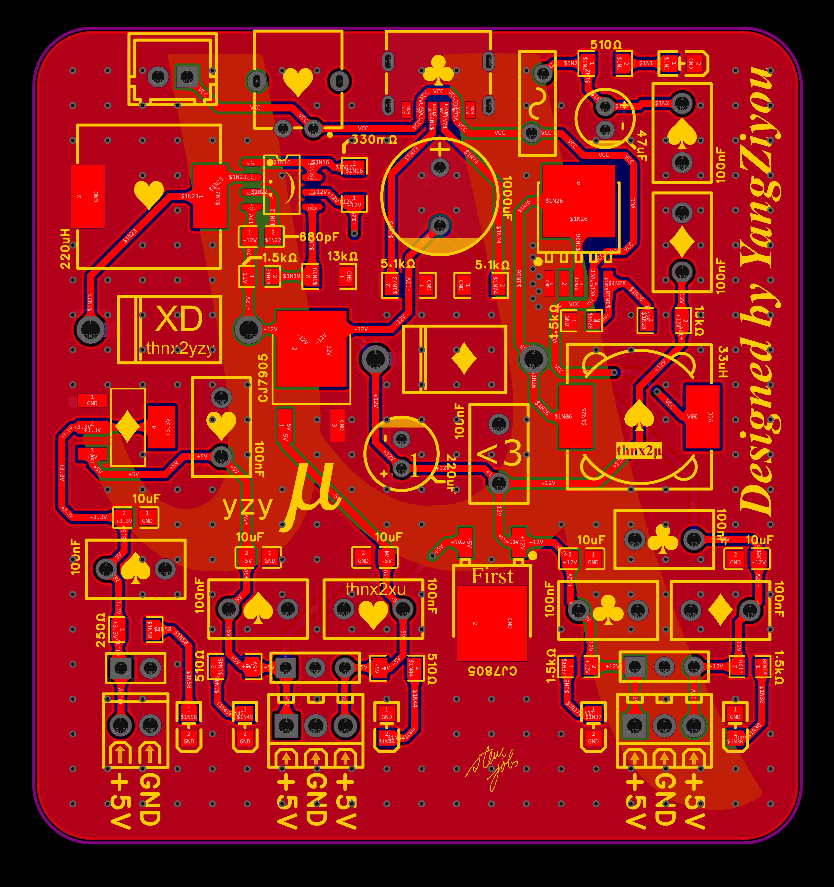
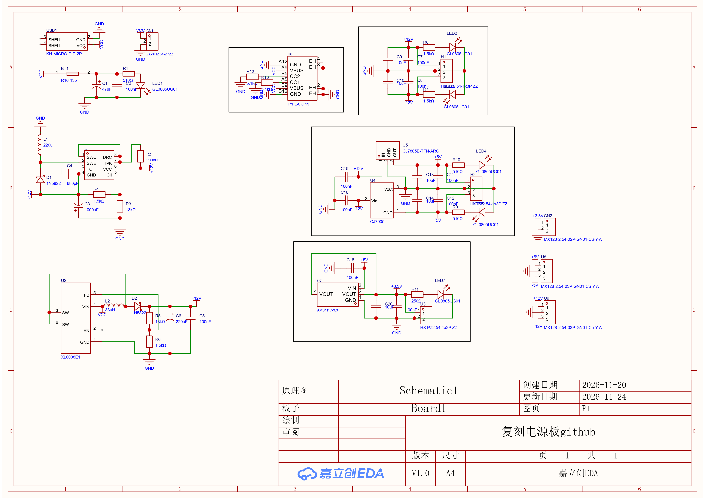
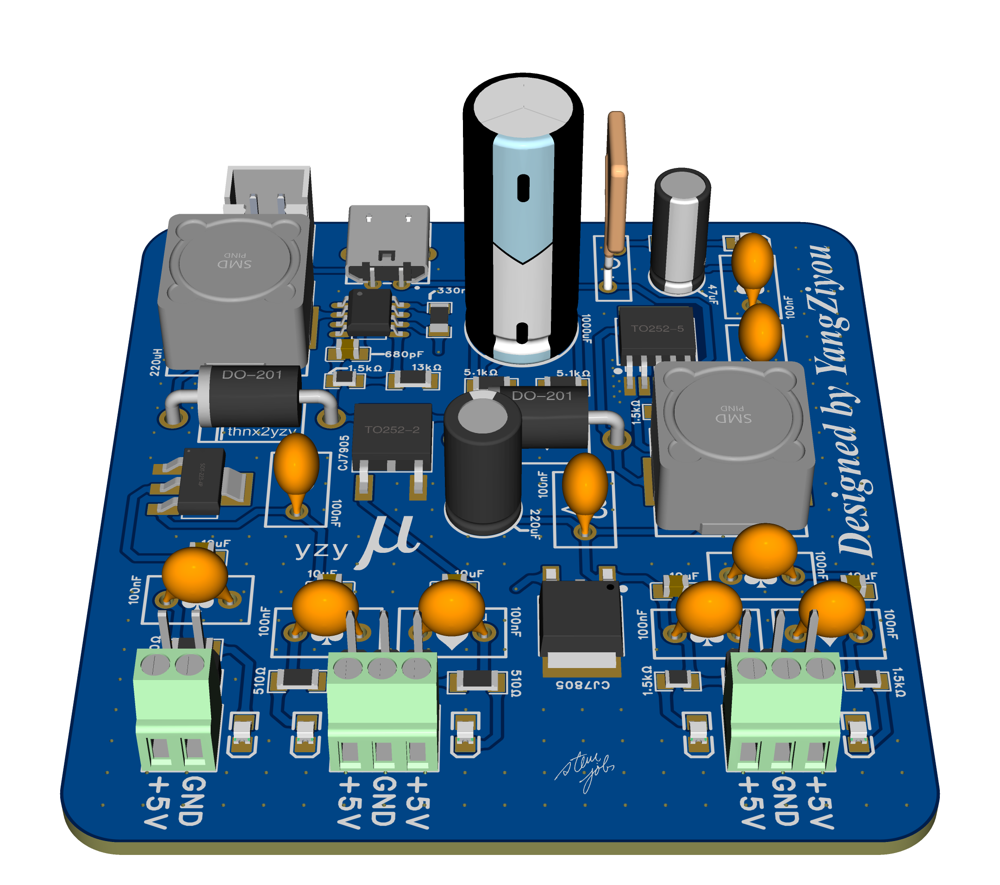

# Multi-Rail Power Board · 多路电源板

**📖 目录 / Index：** [中文](#中文) · [English](#english)

一块板子、一路输入，输出 **+12V / -12V / +5V / -5V / +3.3V** 五路直流电压。

---

## 中文

### 简介

USB-C / Micro-USB / 电池三种输入，一块板子出五路电压，每路独立 LED 指示。

**主要用途：**

- **电子类课程教学与实验演示**——升压、反压、线性、LDO 四种拓扑在一块板上同时可见，讲一路量一路
- **学生课程设计、毕业设计、电子竞赛等 DIY 项目**——一块板解决多路供电，不用东拼西凑电源模块
- 其他：运放双电源、小功放、传感器前端这类需要多种电压的实验电路

### 功能特性

- 三种输入位：USB-C（TYPE-C-6PIN）、Micro-USB、电池座
- 五路输出：升压、反压、线性、LDO 四种拓扑
- 每路独立 LED 指示
- **2.54mm 排针 + 3 组绿色螺纹端子**两种接法
- 工程可在立创EDA专业版里完整编辑

### 输出规格

| 输出 | 器件 | 拓扑 |
| --- | --- | --- |
| **+12V** | XL6008 | 升压变换 |
| **-12V** | 开关变换 | 反压变换 |
| **+5V** | CJ7805 | 线性稳压 |
| **-5V** | CJ7905 | 负压线性稳压 |
| **+3.3V** | AMS1117-3.3 | 低压差线性 |

输出电流取决于器件与散热（线性稳压的压差全部变成热），请实测。

### 接口说明

#### 输入

| 输入口 | 说明 |
| --- | --- |
| **USB-C（TYPE-C-6PIN）** | 主输入，CC1/CC2 各下拉 5.1kΩ，普通 5V 充电头即可 |
| **Micro-USB** | 第二条 5V 路径，兼容老线 |
| **电池座** | 经防反接二极管并入输入母线，可与 USB 并存不倒灌 |

三个输入口接在同一条输入母线上，接哪个都行。

#### 输出

**① 2.54mm 排针**：杜邦头直插，丝印标注对应电压，+12V/-12V/+5V/-5V/+3.3V 全部引出。

**② 绿色螺纹端子**：板子下边缘 3 组，一字螺丝压线，丝印均为 **+5V / GND**。

| 位置 | 位数 | 丝印 |
| --- | --- | --- |
| 左侧 | 2 位 | `+5V` `GND` |
| 中间 | 3 位 | `+5V` `GND` `+5V` |
| 右侧 | 3 位 | `+5V` `GND` `+5V` |

用法：逆时针松开螺丝 → 插入剥好的导线 → 顺时针拧紧压住 → 轻拉确认后上电。
剥线长度 **5–6mm**，接线前先断电。

**端子与排针型号（立创商城）：**

| 器件 | 规格 | 立创编号 |
| --- | --- | --- |
| [MX128-2.54-02P-GN01-Cu-Y-A](https://so.szlcsc.com/global.html?c=&k=C5188442) | 螺钉端子 2P（左侧） | C5188442 |
| [MX128-2.54-03P-GN01-Cu-Y-A](https://so.szlcsc.com/global.html?c=&k=C5188443) | 螺钉端子 3P（中间、右侧） | C5188443 |
| [HX PZ2.54-1x2P ZZ](https://so.szlcsc.com/global.html?c=&k=C32713268) | 排针 2P | C32713268 |
| [HX PZ2.54-1x3P ZZ](https://so.szlcsc.com/global.html?c=&k=C32713269) | 排针 3P | C32713269 |

接线以板上丝印为准，背面焊排针尤其容易镜像。

### 设计原理

- **USB-C 输入**：CC1/CC2 各下拉 5.1kΩ 请求 5V，不做 PD 协商
- **电池输入**：经防反接二极管并入输入母线
- **+12V**：XL6008 升压，L1 220µH + 肖特基整流，分压反馈设定 12V
- **-12V**：电感式反压拓扑，1N5822 整流
- **±5V**：CJ7805 / CJ7905 线性后级，安静但发热
- **+3.3V**：AMS1117-3.3 LDO，输入输出各配 100nF / 10µF
- **指示**：每路串 1.5kΩ 限流点亮 LED

### 关键元件

| 位号 | 器件 | 作用 |
| --- | --- | --- |
| U2 | XL6008 | +12V 升压 |
| U1 | 开关稳压器 | -12V 反压 |
| U4 | CJ7805 | +5V 线性 |
| U5 | CJ7905 | -5V 负压 |
| U7 | AMS1117-3.3 | +3.3V LDO |
| L1 | 220µH | 升压电感 |
| D1 | 1N5822 | 肖特基整流 |
| LED1–5 | GL0805 | 各路指示 |
| R1–R11 | 1.5kΩ / 5.1kΩ / 分压 | 限流、CC 下拉、反馈 |

数值以原理图为准。

### 上手步骤

1. 立创EDA专业版打开工程，查看原理图与 PCB
2. 上电前目检连锡、极性、芯片方向
3. **只上 5V，不接负载**，逐路量 +12V / -12V / +5V / -5V / +3.3V，确认 LED
4. 逐步加负载，注意线性稳压发热

> 量负压时表笔接反对应为 0，容易误判成故障。

### 安全提示

- 实验用 DIY 板，非认证电源，不得用于医疗、汽车等安全相关场合
- 严禁接入市电
- 注意电池座、电解电容、二极管极性
- 多路同板共存，表笔错位可能把 +12V 灌进 3.3V 逻辑
- 开关节点噪声大，示波器地线要短

### 常见问题

- **只用 USB 可以吗？** 可以，五路全部能拉起来。
- **只用电池可以吗？** 可以，接的是同一条输入母线。
- **每路能出多大电流？** 受器件与散热限制，请实测。
- **支持 USB PD 吗？** 不支持，只请求普通 5V。
- **能当正负双电源用？** 能，±12V 和 ±5V 都是共地双极性输出。

### 许可证

**CC BY-NC-SA 4.0**：署名（注明作者 YangZiYou）· 非商业性使用 · 相同方式共享。全文见 [LICENSE](LICENSE)。

### 免责声明

按现状提供，无任何担保。搭建与上电风险自负，因使用本设计造成的设备损坏、财产损失或人身伤害，作者不承担责任。接贵重设备前请自行验证。

### 商业使用限制

仅允许个人学习、实验、教学和非商业项目。未经作者书面许可，不得批量生产销售、集成进商品、提供付费服务或在商业平台上架转售。商用授权请通过 Issue 联系作者。

### 作者

Designed by **YangZiYou**。

### 预览

---

## English

[⬆ Back to Chinese](#中文)

A multi-rail power supply board: USB-C / Micro-USB / battery in, **+12V / -12V / +5V / -5V / +3.3V** out, one LED per rail.

**Main uses:**

- **Electronics teaching and lab demos** — boost, inverting, linear, and LDO topologies all visible on one board, so you can lecture and measure rail by rail
- **Student course projects, final-year projects, electronics competitions, and other DIY builds** — one board covers all the rails instead of scavenging several supply modules
- Also handy for dual-supply op-amp work, small audio amps, and sensor front-ends

### Features

- Three inputs: USB-C (TYPE-C-6PIN), Micro-USB, battery holder
- Five rails: boost, inverting, linear, and LDO topologies
- Per-rail LED indicators
- **2.54 mm headers plus three green screw terminals**
- Fully editable in LCEDA Pro

### Output rails

| Rail | Part | Topology |
| --- | --- | --- |
| **+12V** | XL6008 | Boost |
| **-12V** | Switching | Inverting |
| **+5V** | CJ7805 | Linear |
| **-5V** | CJ7905 | Negative linear |
| **+3.3V** | AMS1117-3.3 | LDO |

Current capability depends on the parts and the heatsinking (linear regulators turn the drop into heat) — measure it.

### Connectors

#### Inputs

| Input | Notes |
| --- | --- |
| **USB-C (TYPE-C-6PIN)** | Main input, 5.1 kΩ pull-downs on CC1/CC2, plain 5V charger is enough |
| **Micro-USB** | Second 5V path for older cables |
| **Battery holder** | Feeds the same bus through a reverse-polarity diode, no back-feed |

All three land on one input bus — use whichever you have.

#### Outputs

**1) 2.54 mm headers** — plug in jumpers; +12V / -12V / +5V / -5V / +3.3V all brought out and silkscreened.

**2) Green screw terminals** — three blocks on the bottom edge, flathead screw clamp, all **+5V / GND**.

| Position | Ways | Silkscreen |
| --- | --- | --- |
| Left | 2 | `+5V` `GND` |
| Middle | 3 | `+5V` `GND` `+5V` |
| Right | 3 | `+5V` `GND` `+5V` |

Loosen counter-clockwise → insert a stripped wire → tighten clockwise → tug to check, then power up.
Strip **5–6 mm**; disconnect power before wiring.

**Part numbers (LCSC):**

| Part | Description | LCSC |
| --- | --- | --- |
| [MX128-2.54-02P-GN01-Cu-Y-A](https://so.szlcsc.com/global.html?c=&k=C5188442) | Screw terminal 2P (left) | C5188442 |
| [MX128-2.54-03P-GN01-Cu-Y-A](https://so.szlcsc.com/global.html?c=&k=C5188443) | Screw terminal 3P (middle, right) | C5188443 |
| [HX PZ2.54-1x2P ZZ](https://so.szlcsc.com/global.html?c=&k=C32713268) | Header 2P | C32713268 |
| [HX PZ2.54-1x3P ZZ](https://so.szlcsc.com/global.html?c=&k=C32713269) | Header 3P | C32713269 |

Follow the silkscreen on your own board; headers soldered from the back are easy to mirror.

### How it works

- **USB-C input**: 5.1 kΩ pull-downs on CC1/CC2 request 5V, no PD negotiation
- **Battery input**: joins the same bus through a reverse-polarity diode
- **+12V**: XL6008 boost with a 220 µH inductor, Schottky rectifier, divider feedback
- **-12V**: inductor-based inverting stage, 1N5822 rectifier
- **±5V**: CJ7805 / CJ7905 linear post-regulation, quiet but hot
- **+3.3V**: AMS1117-3.3 LDO with 100 nF / 10 µF at input and output
- **Indication**: 1.5 kΩ series resistor per LED

### Key components

| Ref | Part | Role |
| --- | --- | --- |
| U2 | XL6008 | +12V boost |
| U1 | Switching regulator | -12V inverting |
| U4 | CJ7805 | +5V linear |
| U5 | CJ7905 | -5V negative |
| U7 | AMS1117-3.3 | +3.3V LDO |
| L1 | 220 µH | Boost inductor |
| D1 | 1N5822 | Schottky rectifier |
| LED1–5 | GL0805 | Rail indication |
| R1–R11 | 1.5 kΩ / 5.1 kΩ / dividers | Limiting, CC pull-downs, feedback |

Values are on the schematic.

### Getting started

1. Open the project in LCEDA Pro and review schematic + PCB
2. Check for bridges, polarity, and part orientation before powering
3. **Power with 5V only, no load**, measure each rail and confirm the LEDs
4. Load incrementally and watch the linear regulators' temperature

> A reversed probe on a negative rail reads 0 and looks like a fault.

### Safety notes

- DIY board, not a certified supply — not for medical, automotive, or safety-critical use
- Never connect mains voltage
- Check battery holder, electrolytic, and diode polarity
- Multiple rails share one board; a slipped probe can short +12V into 3.3V logic
- Switching nodes are noisy — keep scope grounds short

### FAQ

- **USB only?** Yes, all five rails come up.
- **Battery only?** Yes, same input bus.
- **How much current per rail?** Limited by the parts and heatsinking — measure it.
- **USB PD?** No, plain 5V only.
- **Split supply?** Yes, ±12V and ±5V are bipolar pairs with a common ground.

### License

**CC BY-NC-SA 4.0** — attribution (credit YangZiYou) · non-commercial · share-alike. Full text in [LICENSE](LICENSE).

### Disclaimer

Provided as-is, no warranty. All risk in building and powering rests with the user; the author is not liable for equipment damage, property loss, or injury. Verify before connecting anything expensive.

### Commercial use restriction

Personal study, experimentation, teaching, and non-commercial projects only. Without written permission you may not mass-produce and sell, integrate into a product for sale, offer paid services, or list/resell it commercially. For licensing, contact the author via Issues.

### Author

Designed by **YangZiYou**.

### Preview

